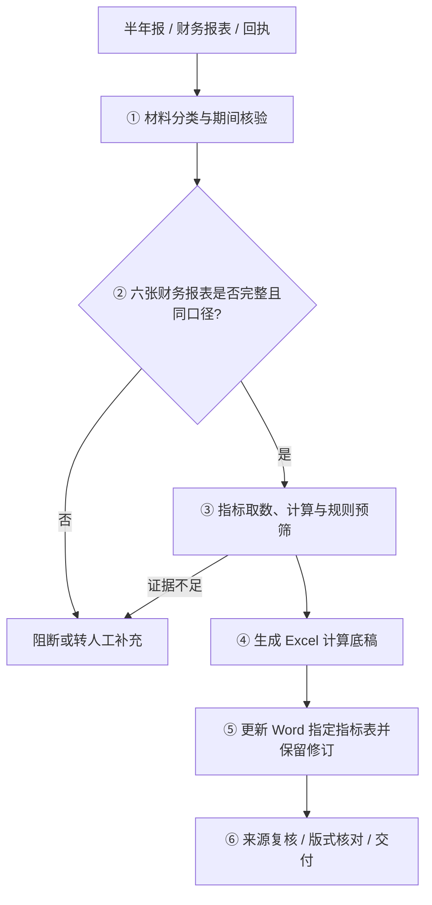

# Quarterly Risk Review Workbench

## 季度风险排查程序｜债券发行人半年报财务核对与回执辅助更新

> A local-first workbench for six-statement financial review, Excel workpaper generation and tracked-change Word updates. **Public portfolio documentation; production source and business templates are not included.**

## 界面


> 上图为原程序空白初始界面的实际截图，不含发行人资料。由于涉及真实业务模板，公开版不展示生产数据或已完成的客户回执。

本项目围绕债券存续期风险排查中的重复性财务核对工作，建立从半年报和财务材料识别、指标计算、Excel 计算底稿编制，到 Word 回执指定表格更新的连续工作流。根据正式来源填写可可靠计算的项目；来源缺失、计算口径不明或需专业判断的内容保留人工复核路径。

**工具定位：** 辅助取数、计算、修订和复核，不代替项目组判断，不自动认定发行人是否发生重大风险。

## 核心能力

| 能力 | 说明 |
|---|---|
| **材料导入与分类** | 浏览器侧读取 DOCX、XLSX、XLS 和 ZIP 等材料，识别风险排查回执、半年报及财务底稿候选文件 |
| **六张财务报表识别** | 按合并、母公司两种口径，识别资产负债表、利润表、现金流量表，并检查缺失、重复或口径不一致问题 |
| **财务指标计算** | 通过科目映射、报告期间识别和预定公式计算能够核实的金额、比例及变动情况；来源不足不倒推、不补造 |
| **Excel 计算底稿** | 在授权的底稿模板基础上更新报表及指标，对需人工补充的空白单元格做明确标识 |
| **Word 原生修订** | 在回执指定财务指标表写入可确认的数值，并保留插入、删除修订记录；非目标区域原则上不做自动改写 |
| **规则预筛与人工复核** | 对可计算指标进行配置规则下的变动预筛；无法判断的指标以及业务原因仍需人工处理，预筛不等于最终结论 |
| **结果输出与核查线索** | 导出计算底稿、修订回执和必要的来源/核对信息，便于逐项复核 |

## 处理流程



## 技术实现

| 层 | 实现 |
|---|---|
| 运行形态 | 原业务版为离线单文件 HTML；浏览器本地处理，不要求远程服务作为处理入口 |
| 前端 | 原生 HTML / CSS / JavaScript，浏览器 File API、下载 API |
| 文档解析 | 基于 OOXML ZIP 包结构分析 DOCX / XLSX；支持旧版 XLS 的浏览器端转换路径 |
| 数据与计算 | 科目和期间映射、合并/母公司口径校验、精确有理数计算及指标规则 |
| 底稿输出 | 修改 Excel 工作簿的表格和单元格数据，并保留模板约定的表单结构 |
| Word 修订 | 使用 OOXML 原生修订节点（如 `w:ins`、`w:del`）记录指定修改 |
| 依赖边界 | 原 HTML 内嵌 JSZip 等浏览器依赖；公开展示版不附带完整运行环境及业务模板 |

## 验证状态

原程序的部分 JavaScript 模块曾通过静态语法检查，但**相关业务源码没有包含在这个公开仓库中**，因此该结果不构成本展示版的可复现功能验收。本仓库未开展可公开复现的浏览器端到端测试、跨发行人回归测试或 Word / Excel 正式验收。

公开版没有业务源码、业务模板和生产样本，因此不提供运行成功率、自动化比例或端到端通过率等未经公开复现的数字。展示图仅用于确认程序界面形态。

## 快速查看

本仓库展示程序的真实空白初始界面、业务流程和技术设计，不提供可执行的完整程序，也不提供完整业务源码。

如需了解实现方式，可参考上面的流程图和技术架构；如需代码审阅或运行演示，应先确认相关材料及源码的知识产权和保密要求，并使用获得授权的独立环境与合成样本。

## 项目结构

```text
README.md                  项目定位、功能说明、技术概览与实际界面
PUBLIC_RELEASE.md          公开范围、限制与复核要求
docs/
  ui-main.png              程序未导入材料时的真实初始界面
.gitignore                 防止常见业务文件误提交
```

## 数据安全

本仓库不包含真实发行人半年报、业务回执、企业名录、内嵌 DOCX/XLSX、历史工作底稿或任何生产输出。**原始离线 HTML 和原始 ZIP 不得直接公开上传**，其中含有与业务相关的内嵌文件。业务源码及具体内部规则不进入本展示仓库；正式业务版本与作品集展示版隔离。

## 许可

本仓库目前未附开源许可证。页面公开可见并不自动授予复制、再分发或商业使用权。发布前还需确认源码归属、所在机构保密义务及第三方依赖使用条件。
