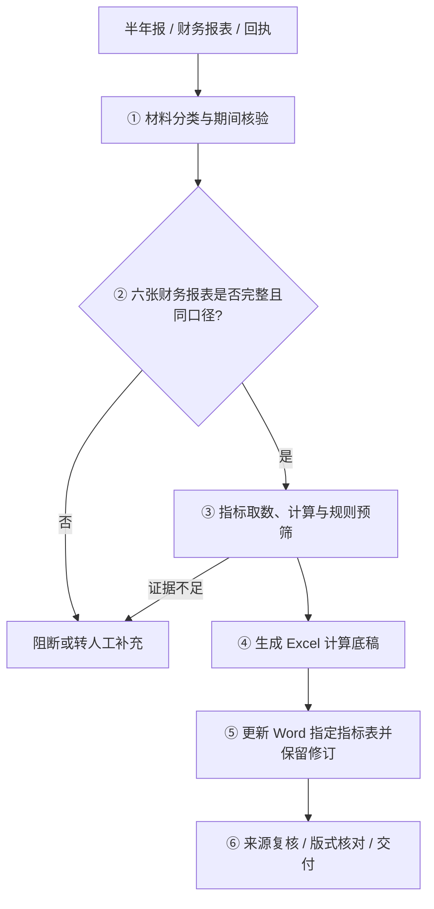

# Quarterly Risk Review Workbench

## 季度风险排查程序｜债券发行人半年报财务核对与回执辅助更新

> A local-first workbench for six-statement financial review, Excel workpaper generation and tracked-change Word updates. **Public portfolio documentation; production source and business templates are not included.**

## 界面


> 原程序未导入资料时的实际界面截图；不包含任何真实业务材料或处理结果。

本项目围绕债券存续期风险排查中的重复性财务核对工作，建立从半年报和财务材料识别、指标计算、Excel 计算底稿编制，到 Word 回执指定表格更新的连续工作流。仅依据可核验的正式来源填写能够可靠计算的指标；来源缺失、口径不明或需专业判断的事项交由人工复核。

**工具定位：** 辅助取数、计算、修订和复核，不代替项目组判断，不自动认定发行人是否发生重大风险。

## 核心能力

| 能力 | 说明 |
|---|---|
| **材料导入与分类** | 浏览器侧读取 DOCX、XLSX、XLS 和 ZIP 等材料，识别风险排查回执、半年报及财务底稿候选文件 |
| **六张财务报表识别** | 按合并、母公司两种口径，识别资产负债表、利润表、现金流量表，并检查缺失、重复或口径不一致问题 |
| **财务指标计算** | 通过科目映射、报告期间识别和预定公式计算能够核实的金额、比例及变动情况；来源不足不倒推、不补造 |
| **Excel 计算底稿** | 在授权的底稿模板基础上更新报表及指标，对需人工补充的空白单元格做明确标识 |
| **Word 原生修订** | 在回执指定财务指标表写入可确认的数值，并保留插入、删除修订记录；非目标区域原则上不做自动改写 |
| **规则预筛与人工复核** | 对可计算指标进行配置规则下的变动预筛；无法判断的指标以及业务原因仍需人工处理，预筛不等于最终结论 |
| **结果输出与核查线索** | 导出计算底稿、修订回执和必要的来源/核对信息，便于逐项复核 |

## 处理流程



## 技术实现

以下说明对应原业务版的技术设计，不表示本公开仓库可直接运行。

| 层 | 实现 |
|---|---|
| 运行形态 | 原业务版为离线单文件 HTML；浏览器本地处理，不要求远程服务作为处理入口 |
| 前端 | 原生 HTML / CSS / JavaScript，浏览器 File API、下载 API |
| 文档解析 | 基于 OOXML ZIP 包结构分析 DOCX / XLSX；支持旧版 XLS 的浏览器端转换路径 |
| 数据与计算 | 科目和期间映射、合并/母公司口径校验、精确有理数计算及指标规则 |
| 底稿输出 | 修改 Excel 工作簿的表格和单元格数据，并保留模板约定的表单结构 |
| Word 修订 | 使用 OOXML 原生修订节点（如 `w:ins`、`w:del`）记录指定修改 |
| 依赖边界 | 原 HTML 内嵌 JSZip 等浏览器依赖；公开展示版不附带完整运行环境及业务模板 |

## 验证状态

本仓库是文档和界面展示版，不含可运行程序、业务模板及测试样本，因此**不构成可公开复现的功能验收**。目前不提供浏览器端到端测试、跨发行人回归测试或 Word / Excel 输出正式验收结果，也不宣称未经公开验证的准确率、自动化比例。

## 快速查看

可直接阅读本页的功能与技术概览，并查看 [程序初始界面截图](docs/ui-main.png)。完整代码审阅或运行演示需要获得相应授权，并使用合成样本及独立测试环境。

## 项目结构

```text
README.md                  项目定位、功能说明、技术概览与实际界面
PUBLIC_RELEASE.md          公开范围、限制与复核要求
docs/
  ui-main.png              程序未导入材料时的真实初始界面
.gitignore                 防止常见业务文件误提交
```

## 数据安全

本仓库仅包含项目介绍、初始界面截图和公开范围说明。原始离线 HTML、业务源码、内嵌模板、发行人资料、历史底稿及运行输出均未公开。详情见 [公开展示范围](PUBLIC_RELEASE.md)。

## 许可

本仓库未附开源许可证。公开展示不自动授予代码或素材的复制、修改、再分发及商业使用许可；进一步开放或复用任何非公开材料均须先确认权利归属和保密义务。
